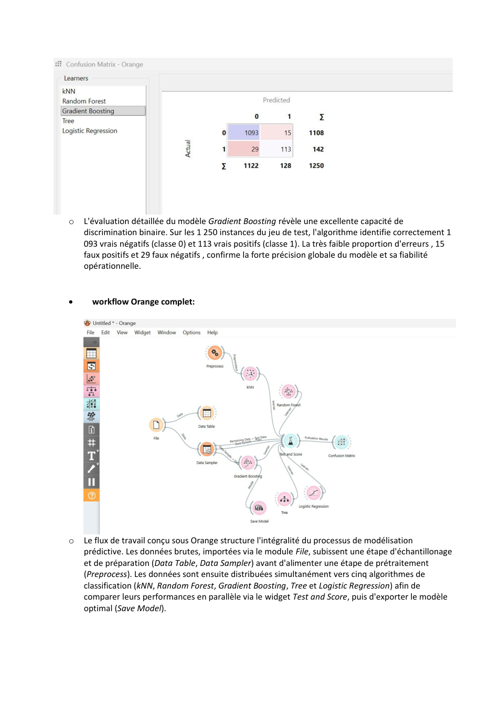
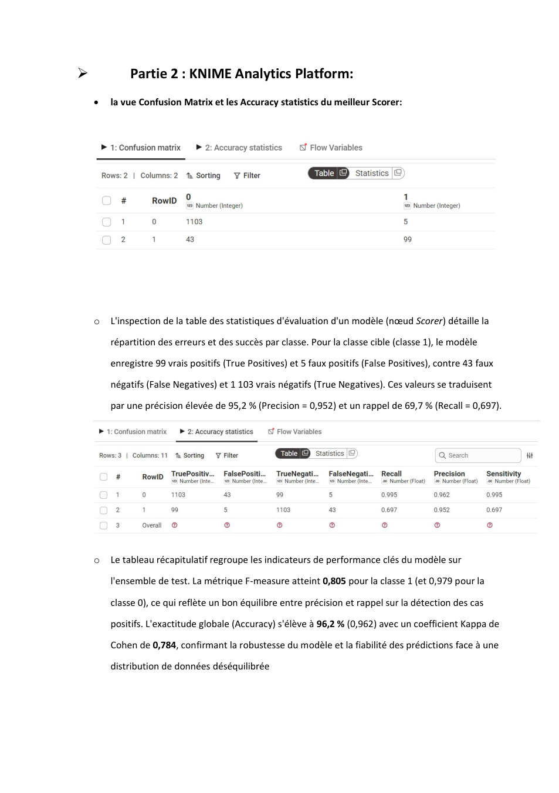
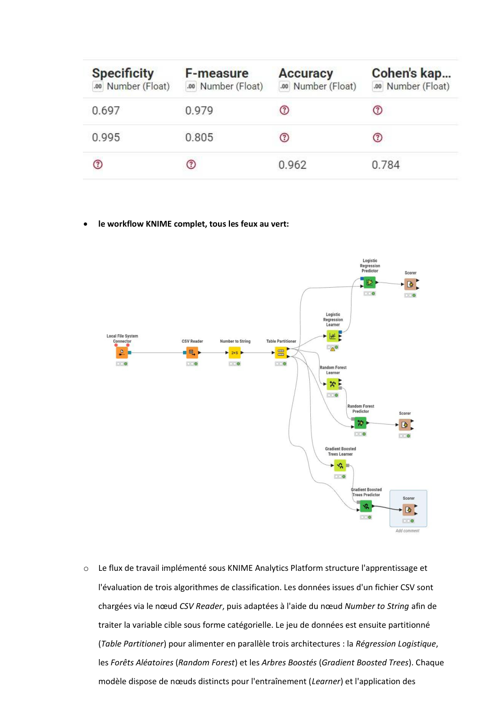
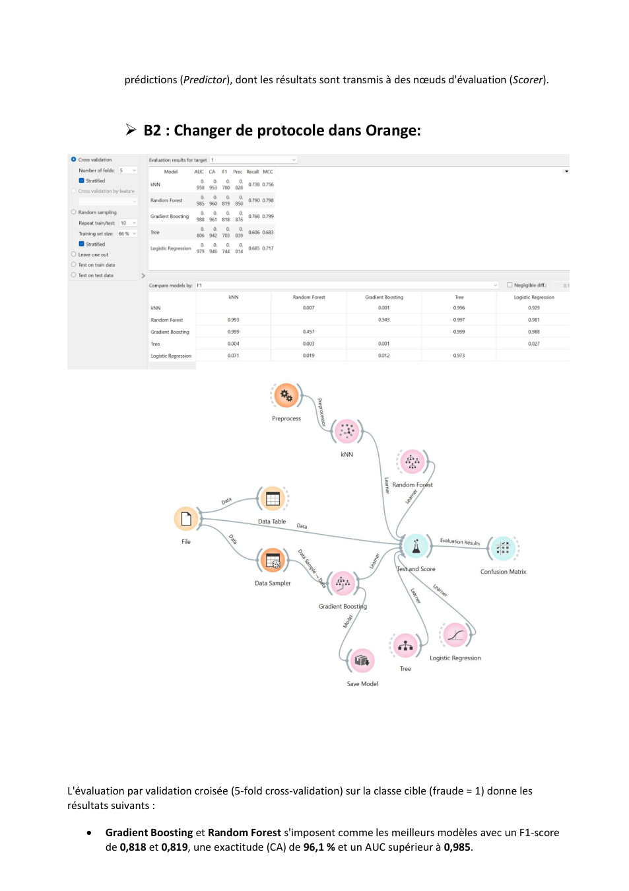

# TP complémentaire Orange / KNIME

## Détection de fraude bancaire

**Étudiant :** Othmane Boushabi  
**Dataset :** 5 000 transactions générées avec la graine 7  
**Cible :** `fraude`  
**Protocole de référence :** séparation stratifiée 75 % / 25 %, `random_state=42`

## 1. Objectif

L’objectif est de construire un pipeline low-code de classification binaire,
d’abord avec Orange puis avec KNIME, afin de comparer plusieurs modèles de
détection de fraude et d’évaluer correctement la classe minoritaire.

Les variables utilisées sont :

| Variable | Description |
|---|---|
| `montant` | montant de la transaction |
| `anciennete` | ancienneté du compte |
| `freq_24h` | fréquence des transactions sur 24 heures |
| `nuit` | indicateur de transaction nocturne |
| `fraude` | cible binaire, 0 ou 1 |

Le dataset contient **4 432 transactions normales** et **568 fraudes**.

## 2. Préparation des données

Le fichier [transactions.csv](../data/transactions.csv) est produit par
[donnees.py](../donnees.py). La génération est déterministe et permet de
reproduire exactement le jeu de données du TP.

Commande :

```powershell
python donnees.py
```

## 3. Évaluation Python de référence

Le script [run_models.py](../run_models.py) sert de contrôle indépendant avant
la construction des workflows visuels.

| Modèle | F1 de la classe fraude |
|---|---:|
| Logistic Regression | 0.7016 |
| kNN normalisé | 0.7812 |
| Tree | 0.7483 |
| Random Forest | 0.7923 |
| Gradient Boosting | 0.8203 |

Matrice de confusion Python du Gradient Boosting :

```text
[[1099,    9],
 [  37,  105]]
```

Le F1 est privilégié à l’accuracy car la classe fraude est minoritaire. Il
combine la précision et le rappel et rend plus visibles les fraudes manquées.

## 4. Workflow Orange

Le workflow est fourni dans [fraude-orange.ows](../workflows/fraude-orange.ows).
Il reprend les blocs suivants :

```text
File -> Data Sampler -> Test and Score -> Confusion Matrix
                         |
                         +-> Logistic Regression
                         +-> kNN
                         +-> Tree
                         +-> Random Forest
                         +-> Gradient Boosting
```

Le Data Sampler doit être réglé sur un échantillonnage stratifié de 75 % avec
la graine 42. Le kNN doit être comparé avant et après normalisation via
Preprocess. La cible `fraude` doit être de type catégoriel et définie comme
variable cible.

Les valeurs de comparaison données par le sujet sont :

| Modèle | F1 attendu |
|---|---:|
| Logistic Regression | 0.781 |
| kNN avant normalisation | 0.478 |
| kNN après normalisation | 0.780 |
| Tree | 0.756 |
| Random Forest avant amélioration | 0.813 |
| Random Forest après amélioration | 0.833 |
| Gradient Boosting | 0.837 |

Ces valeurs sont des valeurs de référence du sujet. Elles ne doivent pas être
présentées comme une nouvelle exécution Orange tant que le workflow n’a pas été
ouvert et exécuté dans Orange sur la machine.

## 5. Workflow KNIME

L’archive [tp-fraude.knwf](../workflows/tp-fraude.knwf) contient la version
persistée du workflow KNIME. Le lecteur CSV est configuré sur le dataset du
projet et le learner de régression logistique est présent.

La chaîne complète à finaliser dans KNIME 5.12 est :

```text
CSV Reader
  -> Number to String (fraude)
  -> Table Partitioner (75/25, stratifié, seed 42)
  -> Logistic Regression Learner -> Predictor -> Scorer
  -> Random Forest Learner       -> Predictor -> Scorer
  -> Gradient Boosted Trees Learner -> Predictor -> Scorer
```

Le `Scorer` doit comparer la colonne `fraude` à `Prediction (fraude)` et
consulter le F-measure de la classe 1. Les nœuds doivent être exécutés dans
l’ordre suivant : lecture, transformation, partition, apprentissage,
prédiction, scoring.

## 6. Réponses aux questions

### Question 1 — Accuracy ou F1 ?

L’accuracy peut être trompeuse avec une classe minoritaire : un modèle qui
prévoit presque toujours « normal » peut obtenir une bonne accuracy tout en
manquant les fraudes. Le F1 combine précision et rappel de la classe fraude.
Le kNN est sensible à l’échelle des variables ; la normalisation évite qu’une
variable à grande amplitude domine les distances.

### Question 2 — Pourquoi fixer une graine ?

Une forêt ou un échantillonnage aléatoire peut produire des résultats
différents à chaque exécution. Une graine fixe permet de reproduire les
résultats, de comparer les outils et de diagnostiquer une régression.

### Question 3 — Quel coût pour les erreurs ?

Une fraude manquée est généralement plus coûteuse qu’une fausse alerte, mais
le coût réel dépend de l’organisation. Le seuil de décision peut être déplacé
pour augmenter le rappel, au prix d’une éventuelle baisse de précision.

### Question 4 — Pourquoi convertir la cible ?

Une colonne `fraude` numérique peut être interprétée comme une variable
quantitative. Dans KNIME, `Number to String` la transforme en catégorie ; dans
Orange, la colonne doit être catégorielle et définie comme cible. Sinon, le
workflow peut sélectionner une régression au lieu d’une classification.

### Question 5 — Orange et KNIME

Orange est très pratique pour expérimenter visuellement et comparer
rapidement des learners. KNIME sépare explicitement les étapes d’apprentissage,
de prédiction et d’évaluation ; il est donc adapté à un flux plus structuré et
à une mise en production collaborative. Orange recalcule plus directement le
graphe, tandis que KNIME indique l’état de chaque nœud.

### Question 6 — Apport de FLAML

FLAML permet d’explorer automatiquement des familles de modèles et des
hyperparamètres avec un budget de temps. Les outils low-code restent utiles
pour comprendre le pipeline et communiquer les résultats. En production, il
faut ajouter validation des données, seuil documenté, tests, traçabilité,
monitoring, analyse des biais et stratégie de réentraînement.

## 7. Limites et reproductibilité

- Les scores Python sont exécutés et vérifiés dans ce projet.
- Les scores Orange du tableau sont les valeurs de référence du sujet ; ils
  doivent être confirmés après installation et exécution d’Orange.
- Le fichier `.pkcls` doit être exporté par Orange lui-même ; il n’est pas
  remplacé par un pickle scikit-learn.
- Les illustrations ci-dessous sont extraites du compte rendu PDF fourni par
  l’étudiant. Elles sont présentées comme références visuelles et non comme
  preuve d’une nouvelle exécution locale.

### Illustrations fournies









## 8. Livrables

- Dataset : [data/transactions.csv](../data/transactions.csv)
- Générateur : [donnees.py](../donnees.py)
- Validation Python : [run_models.py](../run_models.py)
- Workflow Orange : [workflows/fraude-orange.ows](../workflows/fraude-orange.ows)
- Workflow KNIME : [workflows/tp-fraude.knwf](../workflows/tp-fraude.knwf)
- Rapport Word : [rapport_tp_complementaire.docx](../rapport_tp_complementaire.docx)
- Comparatif : [comparatif.md](comparatif.md)

